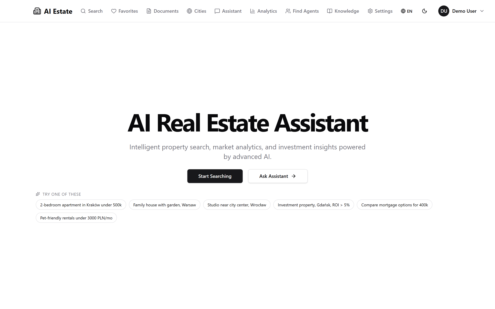
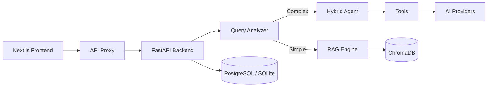

<div align="center">
  
</div>

# AI Real Estate Assistant

**Ask in natural language. Get matched listings.**

An open-source conversational assistant for property search, financial analysis
and market insight. Ask for *"2-bedroom apartment in Kraków under 500k"* and it
answers from a semantic index over your own catalogue — with 16 LLM providers,
a toolbelt behind the chat (mortgage, comparison, ROI, valuation) and nine
languages.

MIT licensed, no signup to look around, and it runs on your own server as
happily as it runs on a managed platform.

[](https://python.org)
[](https://fastapi.tiangolo.com/)
[](https://nextjs.org/)
[](https://www.typescriptlang.org/)
[](https://github.com/AleksNeStu/ai-real-estate-assistant/actions/workflows/ci.yml)
[](LICENSE)
[](https://realty.kittray.com/)
[](https://github.com/AleksNeStu/ai-real-estate-assistant/releases)

<!-- markdownlint-disable MD051 -->
## Table of Contents

- [Live demo](#live-demo)
- [Deploy it your way](#deploy-it-your-way)
- [What's new](#whats-new)
- [What it does](#what-it-does)
- [Why developers pick this](#why-developers-pick-this)
- [Tech stack](#tech-stack)
- [Architecture](#architecture)
- [Quick start](#quick-start)
- [The hosted version, and what comes next](#the-hosted-version-and-what-comes-next)
- [Questions people actually ask](#questions-people-actually-ask)
- [Documentation](#documentation)
- [Testing](#testing)
- [Contributing](#contributing)
- [License](#license)
- [Support](#support)
<!-- markdownlint-restore -->

## Live demo

<div align="center">

### [**Try the live demo →**](https://realty.kittray.com/)

**No login required — explore in demo mode**

</div>



Everything is live in demo mode — no signup, no keys, no setup:

- **Natural-language search** — ask *"2-bedroom apartment in Kraków under 500k"* and get matched listings
- **A real toolbelt behind the chat** — mortgage calculator, rent-vs-buy, ROI, TCO, valuation with a multi-year price forecast
- **Interactive maps** — clustered markers with area analytics
- **Nine languages** — English, Polish, Russian, German, Spanish, Italian, Portuguese, Turkish, Ukrainian
- **Honest about its limits** — the demo answers with a local model so it costs nothing to explore; a real deployment uses the provider key you bring

**Go straight to a part of it:**

| | |
|---|---|
| [Search](https://realty.kittray.com/en/search) | Semantic search over the demo catalogue, with filters and a map |
| [Assistant](https://realty.kittray.com/en/chat) | The chat and its tools — mortgage, ROI, comparison |
| [City overview](https://realty.kittray.com/en/city-overview) | Per-city market analytics |
| [Documents](https://realty.kittray.com/en/documents) | Upload and query your own files |
| [Agents](https://realty.kittray.com/en/agents) | The agent directory and their listings |

## Deploy it your way

There is a live deployment of this project — the demo above runs the release
images, in demo mode, on a server its maintainer controls. You do not have to
stop there: the same images are published on every release, and three ways to
run them are supported today.

| | A hosted platform | Your own VPS | The published images |
|---|---|---|---|
| **What you need** | an account on the platform | a machine with Docker and a spare gigabyte of RAM | a machine with Docker |
| **What you do** | one click, the platform builds and serves it | copy one compose file, `docker compose up -d` | pull two images, point them at your own secrets |
| **Who builds it** | the platform | you — or CI, on every release tag | you, or CI |
| **Your data** | on the platform | on your disk, in your country | on your disk, in your country |
| **Best for** | a demo, a trial, a first look | production, on your own terms | an existing setup that already runs containers |

### On a hosted platform, one click

[](https://render.com/deploy?repo=https://github.com/AleksNeStu/ai-real-estate-assistant)

The blueprint in [`render.yaml`](render.yaml) declares the web service and the
API, the build steps and the health check. The platform builds the images,
serves them and restarts them on every release.

### On your own VPS server

[`deploy/docker-compose.selfhosted.yml`](deploy/docker-compose.selfhosted.yml)
is the whole stack: a FastAPI backend and a Next.js frontend, one persistent
volume, one published port. It needs no paid model key to answer.

```bash
curl -O https://raw.githubusercontent.com/AleksNeStu/ai-real-estate-assistant/main/deploy/docker-compose.selfhosted.yml
cat > .env <<'ENV'
API_ACCESS_KEY=change-me
JWT_SECRET_KEY=change-me
SECURITY_PEPPER=change-me
ENV
docker compose -f docker-compose.selfhosted.yml up -d
```

Put a TLS terminator in front of it — a reverse proxy, a load balancer, a
tunnel — and never expose the port raw.

### With CI instead of a terminal

This repository also ships a
[self-host deploy workflow](.github/workflows/deploy-selfhosted.yml). Give it a
deploy key and the address of your server as repository secrets, and every
release tag rolls your machine onto the new images by itself. Nothing about
your host is stored in this repository — the host, the user, the port and the
path are all secrets you set yourself.

### Or just pull the images

Every release publishes both images to GitHub Container Registry, multi-arch
(amd64 and arm64):

```bash
docker pull ghcr.io/aleksnestu/ai-real-estate-assistant/backend:5.1.10
docker pull ghcr.io/aleksnestu/ai-real-estate-assistant/frontend:5.1.10
```

The full guide — the memory footprint per setup, the published tags and the
Kubernetes variant — is in the [deployment guide](docs/deployment/DEPLOYMENT.md).

## What's new

**v5.1.10** — the demo lives on a domain of its own.

- **A public address that can be printed on a business card** — the demo moved
  from a platform subdomain to `https://realty.kittray.com`, on a domain
  delegated to Cloudflare. The Worker that fronts the deployment keeps its
  custom domain, so the front door did not change — only the name on it.
- **One address in the tree** — the README badge, the live-demo link, the
  `package.json` homepage, `robots.txt`, the sitemap line, `llms.txt`, the
  launch copy and the canonical URL all follow the same value. The public
  address of a deployment is a build argument (`SITE_URL`), so changing it is
  one setting and one release.
- **A mark, a card and half the README** (v5.1.9) — the icon is now a roof
  over a point, in the monochrome the design system asks for; the social
  preview says what the project is; the README is the short version.
- **A second deployment target** (v5.1.8) — the release pipeline now rolls a
  server you own, not only the managed platform. One compose file, one
  workflow, no credentials in the tree.
- **AI property valuation** — paste a property id, get an estimate of the
  current value plus a projection for 1, 3, 5 and 10 years, with a confidence
  band and the key drivers. Try it at `/valuation`.
- **An AI neighbourhood summary** on every property page — what the district
  feels like, what is around it, how easy it is to move around. It falls back
  silently when the model is unavailable.
- **The monthly payment on the card** — every listing shows its estimated
  monthly cost next to the title (20 % down, 30 years, 6.5 % APR by default;
  not a lending offer).
- **A first-visit tour** — five steps from the landing page to the features
  that matter, shown once and remembered locally.
- **A citation layer for AI search** — an expanded `llms.txt`, a `robots.txt`
  that names the AI crawlers it wants, `FAQPage` JSON-LD next to the existing
  schemas, a social preview image, and complete metadata in nine locales.
- **335 dependency alerts closed** — every critical and high advisory resolved,
  the floors pinned in both the lock file and the project file.

Full notes: [v5.1.10 release](https://github.com/AleksNeStu/ai-real-estate-assistant/releases/tag/v5.1.10) ·
[changelog](CHANGELOG.md).

## What it does

| | |
|---|---|
| **Conversational search** | Natural-language queries with automatic filter extraction; hybrid semantic + keyword retrieval over ChromaDB with MMR reranking |
| **Financial tools** | Mortgage calculator, rent-vs-buy, ROI, TCO, comparative market analysis, AI valuation with a multi-year forecast |
| **Neighbourhood one-liner** | An AI summary of a district's character, lifestyle and accessibility, on every property page |
| **Maps** | Clustered markers, area comparisons, city-overview analytics |
| **Localisation** | Nine languages with EU AI Act compliance labels on AI output |
| **Security** | OWASP-hardened: rate limiting, audit logging, SSRF protection, dual-mode auth (API key + JWT), progressive security pipeline in CI |

## Why developers pick this

1. **Multi-provider LLM routing** — 16 providers with an automatic fallback
   chain; a per-request provider selection by header or parameter, no code
   change to switch models.
2. **Hybrid RAG + vector search** — a query-complexity classifier routes
   between RAG-only, hybrid RAG with enhancement, and agent-with-tools;
   ChromaDB with MMR reranking for the retrieval.
3. **A complete reference stack** — FastAPI + Next.js 16 + ChromaDB, Docker
   Compose and Kubernetes, CI that ships the images, and a self-host deploy
   path you can point at your own server.

## Tech stack

| Layer | Technology |
|---|---|
| Backend API | FastAPI (Python 3.12+) |
| Frontend | Next.js 16 + React 19 |
| Vector DB | ChromaDB (semantic search + MMR reranking) |
| Relational DB | PostgreSQL / SQLite |
| LLM providers | OpenAI, Anthropic, Google, Grok, DeepSeek, OpenRouter, Together AI, Fireworks AI, HuggingFace, Groq, Mistral, Qwen, ZAI, Moonshot, OpenCode, local Ollama |
| Container | Docker / Docker Compose |
| CI/CD | GitHub Actions (CI, GHCR images, deploy) |
| Monitoring | Uptime Kuma + structured logs |

## Architecture



Full system design: [docs/architecture/large-saas-overview.md](docs/architecture/large-saas-overview.md).

## Quick start

```bash
git clone https://github.com/AleksNeStu/ai-real-estate-assistant.git
cd ai-real-estate-assistant

# Docker, demo mode, no API keys required
cp deploy/compose/.env.example deploy/compose/.env
docker compose -f deploy/compose/docker-compose.yml up --build
# Frontend: http://localhost:3082 · API: http://localhost:8082/docs
```

On Windows, `.\scripts\docker\start.ps1` does the same thing with the ports
assigned for you. For the manual path (uv + npm), the API reference and the
verification scripts, see the [5-minute quickstart](docs/development/QUICKSTART_5MIN.md).

<!-- HOSTED-FUNNEL-START -->
## The hosted version, and what comes next

This repository is the free, open-source version of the product. It is complete
enough to run, to read, to extend and to put in front of your own users — and
it stays that way.

The paid version is being built right now on top of the same engine, as
**PropVector AI**. The split is deliberate and it does not change with the
roadmap:

| Capability | Open source (this repo) | Hosted (PropVector AI) |
|---|---|---|
| Conversational property Q&A, demo catalogue | Free | Included |
| Bring your own LLM keys, local Ollama | Free | Included |
| Vector search (ChromaDB) over your own data | Free | Included |
| Live data feeds and the enrichment pipeline | — | Pro |
| Accounts, favourites, saved searches, alerts | — | Pro |
| AI CRM (lead scoring, drip campaigns, pipeline) | — | Pro / Enterprise |
| CRM connectors (HubSpot, Pipedrive), SSO, MFA | — | Enterprise |
| White-label / self-host support contract | — | Enterprise (custom) |

**Free $0** · **Pro $29/mo** · **Enterprise (custom)** — the tiers reflect the
public roadmap and may move before launch.

[PropVector AI](https://propvectorai.com) is launching soon; the landing
page ships alongside billing. The fastest way to reach the maintainer today
is to [open a Discussion](https://github.com/AleksNeStu/ai-real-estate-assistant/discussions)
with the `[Commercial]` prefix.

### More from the studio

The same team builds these.

| | |
|---|---|
| **[PropVector AI](https://propvectorai.com)** | The hosted version of this project — live data, accounts, AI CRM, enterprise tiers. |
| **[EU AIGap](https://euaigap.co)** | EU AI Act self-assessment for teams that ship AI: classify a system, find the gaps, export the documents. |
| **[NestLab Tech](https://nestlab.tech)** | The studio itself — workflow automation, custom AI software and EU AI Act readiness for clients. |
| **[CheckCV](https://checkcv.co)** · **[TuneCV](https://tunecv.co)** | AI resume analysis and ATS optimisation. |
| **[PoznajSiebie](https://poznajsiebie.pl)** | Self-knowledge through attachment styles — in Polish. |

### Ideas, forks, and other ways to work with us

The backlog of this repository is written in the open, and suggestions are read
and used — a feature request, a provider we do not support yet, a language we
have not translated, a bug you hit while running it on your own server. All of
it is welcome, and none of it needs to be filed as a formal proposal first.

- **Suggest something** — [open an issue](https://github.com/AleksNeStu/ai-real-estate-assistant/issues).
  Ideas, use cases, "I wish it did X" are all legitimate issues.
- **Build on top of it** — fork it, change it, ship it under your own name. The
  licence is MIT; you do not need to ask.
- **Talk to us first** — a [Discussion](https://github.com/AleksNeStu/ai-real-estate-assistant/discussions)
  is the right place for a feature you would like to shape, a deployment you
  would like help with, or a partnership.
- **Work with the studio** — NestLab Tech builds products like this one for
  clients: [workflow automation, custom AI software, EU AI Act readiness](https://nestlab.tech/services?utm_source=github&utm_medium=referral&utm_campaign=product_showcase&utm_content=readme).
<!-- HOSTED-FUNNEL-END -->

## Questions people actually ask

**Can I run it on my own server?**
Yes — that is what the project is for. One compose file, or let this
repository's CI do it: give the [self-host deploy workflow](.github/workflows/deploy-selfhosted.yml)
a key and an address as repository secrets, and every release tag rolls your
machine onto the new images. See [Deploy it your way](#deploy-it-your-way).

**Do I need a paid API key?**
Not to look around. The demo answers with a local model, so it costs nothing
to explore. For real answers you bring your own key — any of 16 providers, or
a local Ollama — and the app falls back to the next one when a provider fails.

**What is the difference to the hosted version?**
The engine is the same. The hosted tier adds live data feeds, accounts, saved
searches, alerts and an AI CRM — see [PropVector AI](https://propvectorai.com).

**Which languages?**
Nine in the interface: English, Polish, Russian, German, Spanish, Italian,
Portuguese, Turkish and Ukrainian. The documentation is English-first.

**Is the data mine?**
Yes, for anything you run yourself: SQLite plus a ChromaDB index on a volume
you own, in your country, behind your own authentication.

**Can I use it commercially?**
MIT. Fork it, change it, ship it. The hosted version is the commercial path
for teams that want the managed pieces instead of running the stack.

## Documentation

| Doc | Description |
|---|---|
| [5-minute quickstart](docs/development/QUICKSTART_5MIN.md) | The shortest path from a clone to a running app |
| [Deployment guide](docs/deployment/DEPLOYMENT.md) | Docker, Kubernetes, the self-host stack and the CI deploy |
| [Architecture](docs/architecture/large-saas-overview.md) | System design, data flow, deployment |
| [API reference](docs/api/API_REFERENCE.md) | All endpoints with examples |
| [User guide](docs/user/USER_GUIDE.md) | How to use the assistant |
| [Testing guide](docs/testing/TESTING_GUIDE.md) | Writing and running tests |
| [Contributing](CONTRIBUTING.md) | Development workflow |
| [Security policy](SECURITY.md) | Reporting and hardening |
| [Changelog](CHANGELOG.md) | Version history |

## Testing

```powershell
.\scripts\testing\test-fast.ps1     # quick test (3-5 min), during development
.\scripts\testing\test-ci.ps1       # full CI (8-12 min), before a commit
```

```bash
./scripts/testing/test-fast.sh      # the same, on Linux and macOS
./scripts/testing/test-ci.sh
```

Backend: pytest with xdist and a 90 % coverage gate. Frontend: Jest with an
80 % gate. Security: Gitleaks, Semgrep, Bandit, Trivy, CodeQL. Full details
in the [testing guide](docs/testing/TESTING_GUIDE.md).

## Contributing

Contributions are welcome — see [CONTRIBUTING.md](CONTRIBUTING.md) for the
workflow, and the [code of conduct](.github/CODE_OF_CONDUCT.md) for the terms.

1. Fork → `git checkout -b feature/short-description`
2. Run the checks locally (`make ci`)
3. Commit: `type(scope): message`
4. Open a PR against `dev`

`dev` is the working branch, `main` is the stable one.

## License

MIT — see [LICENSE](LICENSE).

## Support

If this project saved you a weekend, you can say so here:

[](https://github.com/sponsors/AleksNeStu)
[](https://www.buymeacoffee.com/AleksNeStu)
[](https://ko-fi.com/AleksNeStu)

**Commercial and partnership work** — deployment help, customisation, CRM
integration, or building the next version together — goes through the studio
that maintains this project:

<div align="center">

**[NestLab Tech](https://nestlab.tech?utm_source=github&utm_medium=readme&utm_campaign=support&utm_content=readme)** ·
[Services](https://nestlab.tech/services?utm_source=github&utm_medium=readme&utm_campaign=support&utm_content=readme) ·
[PropVector AI](https://propvectorai.com?utm_source=github&utm_medium=readme&utm_campaign=support&utm_content=readme)

</div>

Or open a [Discussion](https://github.com/AleksNeStu/ai-real-estate-assistant/discussions)
with the `[Commercial]` prefix and it reaches the same team.

---

<div align="center">

**Star this repo if you find it helpful — it is what makes the next version possible.**

Made with Python, FastAPI and Next.js.

Copyright © 2025-2026 [Alex Nesterovich](https://github.com/AleksNeStu)

</div>
