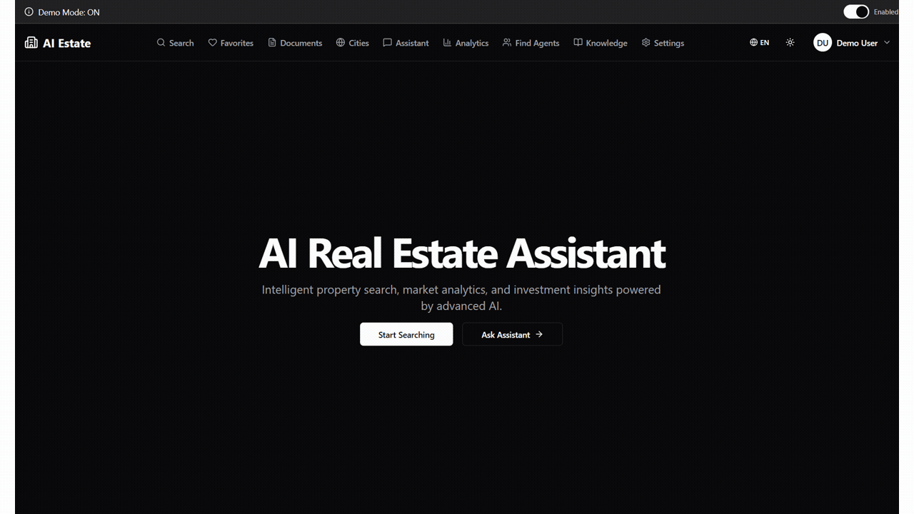
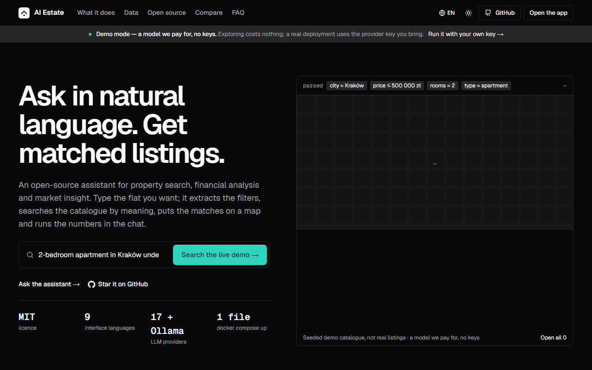
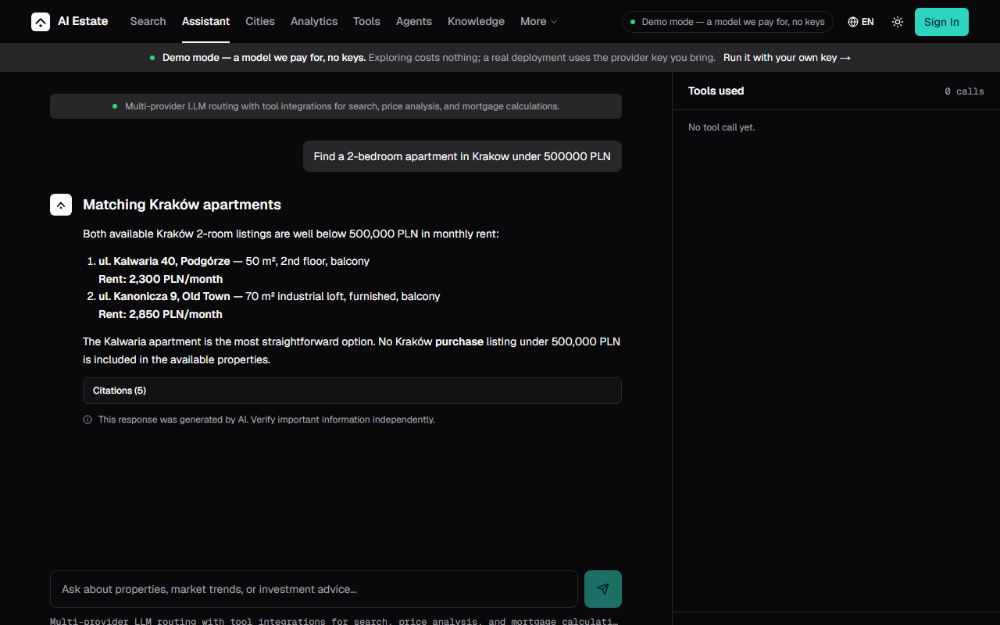
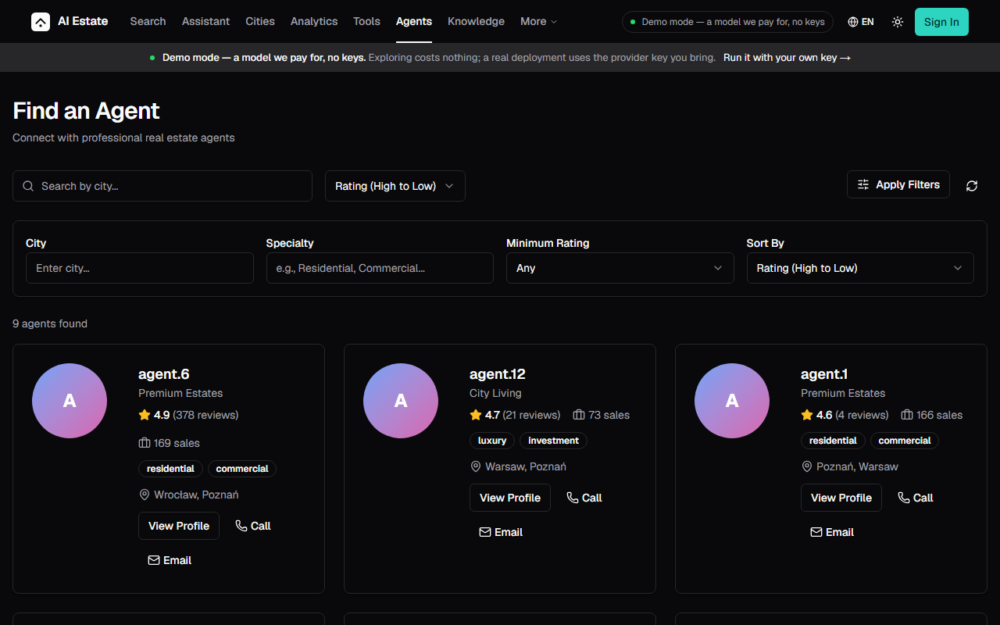
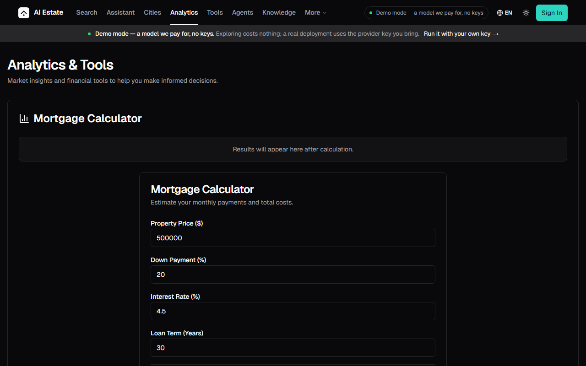
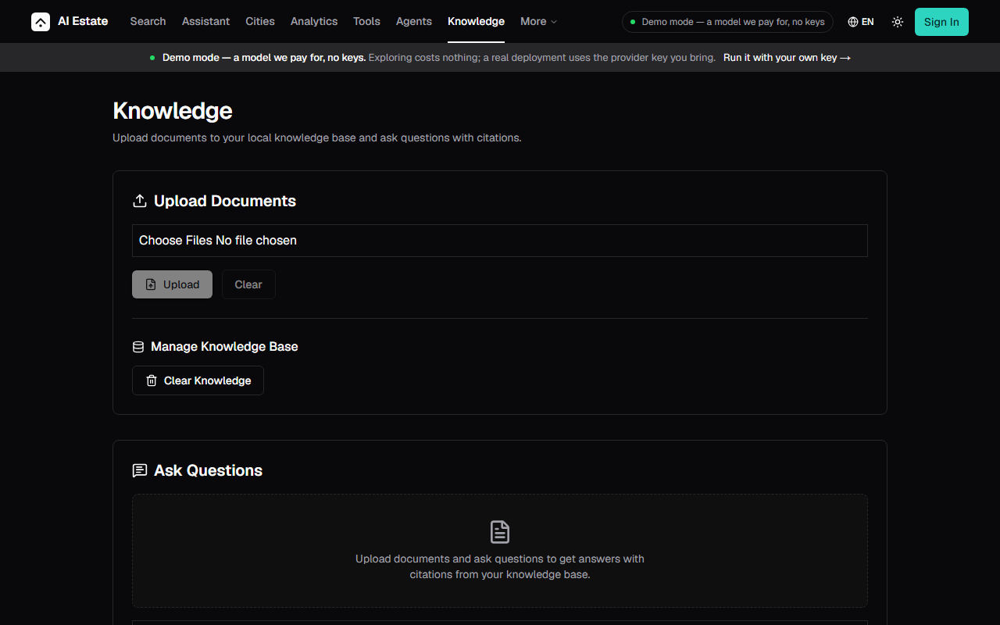
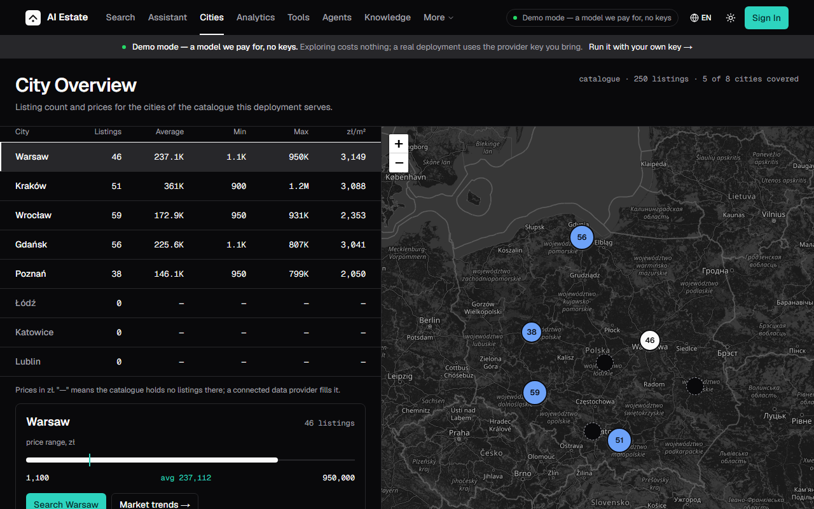
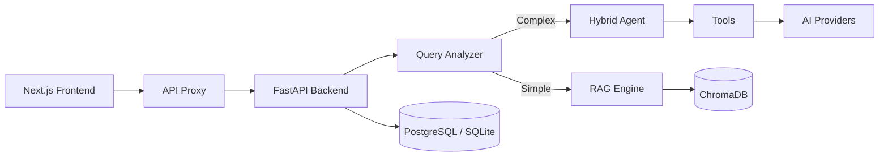

# AI Real Estate Assistant

**Ask in natural language. Get matched listings.**

An open-source conversational assistant for property search, financial analysis and market insight.
Ask for *"2-bedroom apartment in Kraków under 500k"* and it answers from a semantic index over your
own catalogue — with 16 LLM providers, a full toolbelt behind the chat (mortgage, comparison, ROI,
valuation), and nine languages.

MIT licensed, no signup to look around, and it runs on your own server as happily as it runs on a
managed platform.

> **NestLab Tech** builds this in the gaps between client projects — a founder-led AI studio in
> Poland (EU).
> [Workflow automation, custom AI software and EU AI Act readiness](https://nestlab.tech/services?utm_source=github&utm_medium=referral&utm_campaign=product_showcase&utm_content=readme)

[](https://python.org)
[](https://fastapi.tiangolo.com/)
[](https://nextjs.org/)
[](https://www.typescriptlang.org/)
[](https://github.com/AleksNeStu/ai-real-estate-assistant/actions/workflows/ci.yml)
[](LICENSE)
[](https://ai-real-estate-demo.devs-scaler.workers.dev/)
[](https://propvectorai.com?utm_source=github&utm_medium=readme&utm_campaign=hosted-badge)
[](https://github.com/AleksNeStu/ai-real-estate-assistant/releases)

<!-- markdownlint-disable MD051 -->
## Table of Contents

- [Live Demo](#live-demo)
- [Deploy it your way](#deploy-it-your-way)
- [What's New in v5.1.7](#whats-new-in-v517)
- [Local Demo Setup](#local-demo-setup)
- [Deployment & Memory Notes](#deployment--memory-notes)
- [Screenshots](#screenshots)
- [Features](#features)
- [Tech Stack](#tech-stack)
- [Project Growth](#project-growth)
- [Releases](#releases)
- [Architecture](#architecture)
- [Quick Start](#quick-start)
- [Three Developer Differentiators](#three-developer-differentiators)
- [The hosted version, and what comes next](#the-hosted-version-and-what-comes-next)
- [Project Structure](#project-structure)
- [Testing](#testing)
- [Documentation](#documentation)
- [Roadmap](#roadmap)
- [Branches](#branches)
- [Deployment](#deployment)
- [Configuration](#configuration)
- [Contributing](#contributing)
- [License](#license)
- [Contributors](#contributors)
- [Support](#support)

## Live Demo

<div align="center">

### [**🚀 Try the Live Demo →**](https://ai-real-estate-demo.devs-scaler.workers.dev/)

**No login required — explore in demo mode**

</div>

Everything is live in demo mode — no signup, no keys, no setup:

- **Natural-language search** — ask *"2-bedroom apartment in Kraków under 500k"* and get matched listings
- **A real toolbelt behind the chat** — mortgage calculator, rent-vs-buy, ROI, TCO, valuation with a multi-year price forecast
- **Interactive maps** — clustered markers with area analytics
- **Nine languages** — English, Polish, Russian, German, Spanish, Italian, Portuguese, Turkish, Ukrainian
- **Honest about its limits** — the demo answers with a local model so it costs nothing to explore; a real deployment uses the provider key you bring

## Deploy it your way

Two supported paths, and the choice is yours. Both run the same images.

| | Platform-hosted | Your own server |
|---|---|---|
| **What you need** | an account on the platform | a machine with Docker and a spare gigabyte of RAM |
| **What you do** | one click, the platform builds and serves it | copy one compose file, `docker compose up -d` |
| **Your data** | on the platform | on your disk, in your country |
| **Who upgrades it** | the platform | you — or CI, on every release tag |

### Platform-hosted, one click

[](https://render.com/deploy?repo=https://github.com/AleksNeStu/ai-real-estate-assistant)

The blueprint in [`render.yaml`](render.yaml) declares the web service and the API, the build steps and
the health check. The platform builds the images, serves them and restarts them on every release.

### Your own server, with or without CI

[`deploy/docker-compose.selfhosted.yml`](deploy/docker-compose.selfhosted.yml) is the whole stack:
a FastAPI backend and a Next.js frontend, one persistent volume, one published port. It needs no
paid model key to answer.

```bash
curl -O https://raw.githubusercontent.com/AleksNeStu/ai-real-estate-assistant/dev/deploy/docker-compose.selfhosted.yml
cat > .env <<'ENV'
API_ACCESS_KEY=change-me
JWT_SECRET_KEY=change-me
SECURITY_PEPPER=change-me
ENV
docker compose -f docker-compose.selfhosted.yml up -d
```

Put a TLS terminator in front of it — a reverse proxy, a load balancer, a tunnel — and never expose
the port raw.

**With CI instead of a terminal:** this repository also ships a
[self-host deploy workflow](.github/workflows/deploy-selfhosted.yml). Give it a deploy key and the
address of your server as repository secrets, and every release tag rolls your machine onto the new
images by itself. Nothing about your host is stored in this repository — the host, the user, the
port and the path are all secrets you set yourself.

## What's New in v5.1.7

The current release. Everything here works in demo mode, without a paid
external API.

- **A second deployment target** — the release pipeline now rolls a server you
  own, not only the managed platform. One compose file, one workflow, no
  credentials in the tree.
- **A request counter that cannot take a response down** — the metrics counter
  was read without a guard, and a request that arrived before the first
  measurement could be answered with a 500. It now heals itself instead.
- **AI property valuation** — paste a property id, get an estimate of the
  current value plus a projection for 1, 3, 5 and 10 years, with a confidence
  band and the key drivers. Try it at `/valuation`.
- **An AI neighborhood summary** on every property page — what the district
  feels like, what is around it, how easy it is to move around. It falls back
  silently when the model is unavailable.
- **The monthly payment on the card** — every listing shows its estimated
  monthly cost next to the title (20 % down, 30 years, 6.5 % APR by default;
  not a lending offer).
- **A first-visit tour** — five steps from the landing page to the features
  that matter, shown once and remembered locally.
- **Input that is no longer mangled** — the control-character filter was
  rewriting every character below `0x3E`, so `"2 bedroom under 500000 EUR"`
  reached the model as `"2\x97bedroom\x82under…"`. It now removes exactly the
  control characters it means to, and the fix is covered by tests.
- **One layout contract** — sixteen wrapper variants, three pages running edge
  to edge. Every route now uses the same container, and the hero, the chat
  pane and the auth card keep the layouts they actually need.
- **A citation layer for AI search** — an expanded `llms.txt`, a `robots.txt`
  that names the AI crawlers it wants, `FAQPage` JSON-LD next to the existing
  schemas, a social preview image, and complete metadata in nine locales.
- **335 dependency alerts closed** — every critical and high advisory resolved,
  the floors pinned in both the lock file and the project file, one accepted
  LOW documented with its reason.
- **Smaller page weight** — the charts bundle is loaded only when the charts
  are on screen, which takes about 5 MB off the market-trends page.

Full notes: [v5.1.7 release](https://github.com/AleksNeStu/ai-real-estate-assistant/releases/tag/v5.1.7) ·
[changelog](CHANGELOG.md).

## Local Demo Setup

Run the full demo locally with comprehensive mock data in minutes:

```powershell
# Step 1: Launch Docker containers (5-8 min)
.\scripts\demo\01-launch-docker.ps1

# Step 2: Generate comprehensive demo data (2-3 min)
.\scripts\demo\02-generate-data.ps1

# Access the demo
# Frontend: http://localhost:3082
# Backend:  http://localhost:8082
# API Docs: http://localhost:8082/docs
```

**Demo Data Includes:**

- 🏠 250+ properties across 5 Polish cities (Kraków, Warsaw, Gdańsk, Wrocław, Poznań)
- 👥 50 users with different roles
- 🔍 100 saved searches with diverse filters
- ⭐ 200 favorites across users
- 🏢 15 real estate agent profiles
- 📊 150 leads/inquiries
- 📈 300 activity events
- ⚙️ 40 preference profiles
- 📋 20 CMA reports

**Stop the demo:**

```powershell
.\scripts\demo\03-stop-docker.ps1
```

**[→ Demo Setup Documentation](scripts/demo/README.md)** — Complete guide with troubleshooting.

## Deployment & Memory Notes

The backend uses an **environment-conditional lazy provider load** (`apps/api/models/provider_factory.py`) so it can run on a memory-constrained host. This is **only triggered when the `RENDER` env var is set to `"true"`**.

| Setup | `RENDER` set? | Provider loading | Memory baseline | Notes |
|---|---|---|---|---|
| **Memory-constrained host** | ✅ yes | Lazy — only the active `DEFAULT_PROVIDER` (`zai`) is imported at startup; the other 15 are loaded on first use | ~480 MB | Workaround for a small memory cap |
| **VPS / bare metal** | ❌ no | Eager — all 16 providers imported at startup | ~530 MB | No memory constraint; full DX |
| **Docker / docker-compose** (local or self-hosted) | ❌ no (unless you set it) | Eager — all 16 providers imported at startup | ~530 MB | Same as VPS |
| **Other PaaS** | ❌ no | Eager — all 16 providers imported at startup | depends on instance type | Pick a plan with ≥1 GB RAM for safety |
| **Local dev / CI** | ❌ no | Eager | ~530 MB | Tests assume this path |

If you self-host on a VPS, Docker, or any platform with headroom, **you don't need to do anything** — the eager path gives you all 16 providers from the start with no artificial latency. The lazy path exists for small memory caps and is **not** a best practice for memory-constrained production deployments in general.

To override the gate (e.g. force lazy loading on a different platform), set `RENDER=true` in the environment.


## Screenshots

<div align="center">



*Homepage · Search · Chat · Agents · Analytics*

</div>

### What it looks like

| Landing | AI Assistant | AI Agents |
|---|---|---|
|  |  |  |
| Analytics | Knowledge & RAG | City Overview |
|  |  |  |

*All dark-theme desktop captures (1280x800). Working source files live in
`assets/screenshots/*-dark.png`. Light-theme variants are available in
`docs/screenshots/`.*

## Features

### Multi-Provider AI
16 LLM providers with intelligent routing — OpenAI, Anthropic, Google, Grok, DeepSeek, OpenRouter, Together AI, Fireworks AI, HuggingFace, Groq, Mistral, Qwen, ZAI, Moonshot, OpenCode, and local Ollama. Automatic fallback chain ensures reliability.

### Smart Property Search
Natural language queries with automatic filter extraction. Hybrid semantic + keyword search powered by ChromaDB with MMR reranking for 30-40% better relevance.

### Analytics & Financial Tools
Mortgage calculator, rent-vs-buy comparison, investment ROI analysis, TCO calculator, Comparative Market Analysis (CMA) reports, and **AI price forecast with multi-year projection** (v5.1).

### AI Neighborhood One-Liner (v5.1)
Short 2-3 sentence AI summary of any neighborhood's character, lifestyle, and accessibility — appears on property detail pages.

### Interactive Maps
Mapbox/Leaflet maps with property clustering, area comparisons, and city-overview analytics.

### 9 Languages
English, Polish, Russian, German, Spanish, Italian, Portuguese, Turkish, and Ukrainian — with EU AI Act compliance labels.

### Enterprise Security
OWASP-hardened with rate limiting, audit logging, SSRF protection, and dual-mode auth (API Key + JWT). Progressive 5-stage security pipeline with full scanning on all branches.

## Tech Stack

| Layer | Technology |
|-------|------------|
| Backend API | FastAPI (Python 3.12+) |
| Frontend | Next.js 16 + React 19 |
| Vector DB | ChromaDB (semantic search + MMR reranking) |
| Relational DB | PostgreSQL / SQLite |
| LLM Providers | OpenAI, Anthropic, Google, Grok, DeepSeek, OpenRouter, Together AI, Fireworks AI, HuggingFace, Groq, Mistral, Qwen, ZAI, Moonshot, OpenCode, local Ollama |
| Container | Docker / Docker Compose |
| Hosting (demo) | Single host behind a reverse proxy |
| CI/CD | GitHub Actions (CI + GHCR) |
| Monitoring | Uptime Kuma + structured logs |

## Project Growth

### GitHub Stats

[](https://github.com/AleksNeStu/ai-real-estate-assistant)
[](https://github.com/AleksNeStu/ai-real-estate-assistant)
[](https://github.com/AleksNeStu/ai-real-estate-assistant/issues)

### Star Growth

<a href="https://www.star-history.com/?repos=AleksNeStu%2Fai-real-estate-assistant&type=date&legend=top-left">
 <picture>
   <source media="(prefers-color-scheme: dark)" srcset="https://api.star-history.com/chart?repos=AleksNeStu/ai-real-estate-assistant&type=date&theme=dark&legend=top-left&sealed_token=dLC4gJOVgeG09m7gDw6tGkSgeC4LuX04JcxV3JVmuT5WvbqKDcK2GqcNVEoOgCR4bdavGcnZ65FOoYtoD-H6ZLNYXi-fZ9OYJg40eYMSvPHzI7lF5AFGEEjzM4hW0Syw5w3k4z7WQxW_o2Ma9dQBt05krBqubuxW3x-IdcKs571mTRCs5pYchSXnspIC" />
   <source media="(prefers-color-scheme: light)" srcset="https://api.star-history.com/chart?repos=AleksNeStu/ai-real-estate-assistant&type=date&legend=top-left&sealed_token=dLC4gJOVgeG09m7gDw6tGkSgeC4LuX04JcxV3JVmuT5WvbqKDcK2GqcNVEoOgCR4bdavGcnZ65FOoYtoD-H6ZLNYXi-fZ9OYJg40eYMSvPHzI7lF5AFGEEjzM4hW0Syw5w3k4z7WQxW_o2Ma9dQBt05krBqubuxW3x-IdcKs571mTRCs5pYchSXnspIC" />
   
 </picture>
</a>

### Key Metrics

| Metric           | Value                                       |
| ---------------- | ------------------------------------------- |
| **Commits**      | 191                                         |
| **Tests**        | 7,000+ (6,254 backend + 1,000 frontend)     |
| **Lines of Code** | 60,000+ (27K Python + 34K TypeScript)      |
| **Contributors** | 5 (+ 1 bot)                                 |
| **Languages**    | 9 supported                                 |

## Releases

| Version | Date | Highlights |
|---|---|---|
| [v5.1.7](CHANGELOG.md#517---2026-11-07) | 2026-11-07 | Second deployment target (your own server, with or without CI), a request counter that cannot fail a request |
| [v5.1.6](CHANGELOG.md#516---2026-11-06) | 2026-11-06 | 335 → 0 open Dependabot alerts, input-sanitization fix (#377), one page-container contract across all routes |
| [v5.1.5.2](CHANGELOG.md#5152---2026-09-12) | 2026-09-12 | HIGH/CRITICAL CVE fix batch: Next.js RCE (CVSS 9.0), gitpython RCE (CVSS 9.8), sharp libheif, js-yaml CPU-DoS |
| [v5.1.5](CHANGELOG.md#515---2026-09-06) | 2026-09-06 | Visibility/SEO/GEO surface, star-history hosted embed, Dependabot roll-up, CI hardening |
| [v5.0.12](CHANGELOG.md#5012---2026-06-22) | 2026-06-22 | Flaky-test fix, deploy independence, release verification workflow |
| [v5.0.11](CHANGELOG.md#5011---2026-06-22) | 2026-06-22 | `pydantic-settings` CVE, dependabot config fix, first GitHub Release page |
| [v5.0.10](CHANGELOG.md#5010---2026-06-20) | 2026-06-20 | `aiohttp` 9 advisories, `fastapi` 4 advisories, starlette direct dep |

See [GitHub Releases](https://github.com/AleksNeStu/ai-real-estate-assistant/releases)
and [CHANGELOG.md](CHANGELOG.md) for the full version history. Going forward, each
release ships with a themed name and a short narrative paragraph — see
[`.github/RELEASE_TEMPLATE.md`](.github/RELEASE_TEMPLATE.md).

## Architecture



See [docs/architecture/large-saas-overview.md](docs/architecture/large-saas-overview.md) for the full system design.

## Quick Start

### PowerShell Scripts (recommended for Windows)

```powershell
# Clone and start demo mode (no API keys required)
git clone https://github.com/AleksNeStu/ai-real-estate-assistant.git
cd ai-real-estate-assistant
.\scripts\docker\start.ps1

# Stop:  .\scripts\docker\stop.ps1
# Logs:  .\scripts\docker\logs.ps1
```

### Docker (manual)

```bash
git clone https://github.com/AleksNeStu/ai-real-estate-assistant.git
cd ai-real-estate-assistant
cp deploy/compose/.env.example deploy/compose/.env
# Edit deploy/compose/.env — demo mode enabled by default
docker compose -f deploy/compose/docker-compose.yml up --build
# Frontend: http://localhost:3082 · API: http://localhost:8082/docs
```

### Manual

```bash
# Backend
cd apps/api && uv venv .venv && source .venv/bin/activate
uv pip install -e ".[dev]" && python -m uvicorn api.main:app --reload --port 8000

# Frontend
cd apps/web && npm install && npm run dev
# Frontend: http://localhost:3000 · API: http://localhost:8000
```

> **[5-Minute Quickstart →](docs/development/QUICKSTART_5MIN.md)** — Full setup with verification scripts.

## Three Developer Differentiators

### 1. Multi-Provider LLM Routing
16 LLM providers with automatic fallback chain — OpenAI, Anthropic, Google, Grok, DeepSeek, OpenRouter, Together AI, Fireworks AI, HuggingFace, Groq, Mistral, Qwen, ZAI, Moonshot, OpenCode, and local Ollama. Per-request provider selection via header or request parameter; no code changes required to switch models.

### 2. Hybrid RAG + ChromaDB Vector Search
Query complexity classifier routes requests to RAG-only (simple), hybrid RAG+enhancement (medium), or agent+tools (complex). ChromaDB with MMR reranking provides semantic similarity search.

### 3. 9-Language Localization
English, Polish, Russian, German, Spanish, Italian, Portuguese, Turkish, and Ukrainian — with EU AI Act compliance labels on AI-generated outputs.

<!-- HOSTED-FUNNEL-START -->
## The hosted version, and what comes next

This repository is the free, open-source version of the product. It is complete
enough to run, to read, to extend and to put in front of your own users — and
it stays that way.

The paid version is being built right now on top of the same engine, as
**PropVector AI**. The split is deliberate and it does not change with the
roadmap:

| Capability | Open source (this repo) | Hosted (PropVector AI) |
|---|---|---|
| Conversational property Q&A, demo catalogue | Free | Included |
| Bring your own LLM keys, local Ollama | Free | Included |
| Vector search (ChromaDB) over your own data | Free | Included |
| Live data feeds and the enrichment pipeline | — | Pro |
| Accounts, favourites, saved searches, alerts | — | Pro |
| AI CRM (lead scoring, drip campaigns, pipeline) | — | Pro / Enterprise |
| CRM connectors (HubSpot, Pipedrive), SSO, MFA | — | Enterprise |
| White-label and self-host support contract | — | Enterprise (custom) |

**Free $0** · **Pro $29/mo** · **Enterprise (custom)** — the tiers reflect the
public roadmap and may move before launch.

[PropVector AI](https://propvectorai.com) is launching soon; the landing page
ships alongside billing. The fastest way to reach the maintainer today is to
[open a Discussion](https://github.com/AleksNeStu/ai-real-estate-assistant/discussions)
with the `[Commercial]` prefix.

### Ideas, forks, and other ways to work with us

The backlog of this repository is written in the open, and suggestions are read
and used — a feature request, a provider we do not support yet, a language we
have not translated, a bug you hit while running it on your own server. All of
it is welcome, and none of it needs to be filed as a formal proposal first.

- **Suggest something** — [open an issue](https://github.com/AleksNeStu/ai-real-estate-assistant/issues).
  Ideas, use cases, "I wish it did X" are all legitimate issues.
- **Build on top of it** — fork it, change it, ship it under your own name. The
  licence is MIT; you do not need to ask.
- **Talk to us first** — a [Discussion](https://github.com/AleksNeStu/ai-real-estate-assistant/discussions)
  is the right place for a feature you would like to shape, a deployment you
  would like help with, or a partnership.
- **Work with the studio** — NestLab Tech builds products like this one for
  clients: [workflow automation, custom AI software, EU AI Act readiness](https://nestlab.tech/services?utm_source=github&utm_medium=referral&utm_campaign=product_showcase&utm_content=readme).
<!-- HOSTED-FUNNEL-END -->

## Project Structure

```text
ai-real-estate-assistant/
├── apps/
│   ├── api/                    # FastAPI backend (Python 3.12+)
│   │   ├── api/                # Routers, main.py, dependencies
│   │   ├── agents/             # HybridAgent, QueryAnalyzer
│   │   ├── tools/              # LangChain tools
│   │   ├── models/             # LLM provider factory
│   │   ├── db/                 # SQLAlchemy models, repositories
│   │   ├── vector_store/       # ChromaDB integration
│   │   └── tests/              # pytest unit/integration/e2e
│   └── web/                    # Next.js 16 frontend (React 19)
│       └── src/
│           ├── app/            # App Router pages
│           ├── components/     # UI components
│           ├── contexts/       # React contexts
│           └── lib/            # API client, utilities
├── deploy/                     # Dockerfiles, compose files, k8s
├── docs/                       # Architecture, API, guides
├── scripts/                    # dev, demo, validation, setup
└── .github/                    # CI/CD, FUNDING, issue templates
```

## Testing

### Quick Commands

**Windows:**
```powershell
.\scripts\testing\test-fast.ps1       # ⚡ Quick test (3-5 min) - during development
.\scripts\testing\test-ci.ps1         # 🔍 Full CI (8-12 min) - before commit
.\scripts\testing\test-all.ps1        # 🐛 See all failures - fixing multiple issues
.\scripts\testing\test-coverage.ps1   # 📊 Coverage report - before PR
```

**Linux/macOS:**
```bash
./scripts/testing/test-fast.sh        # ⚡ Quick test (3-5 min)
./scripts/testing/test-ci.sh          # 🔍 Full CI (8-12 min)
./scripts/testing/test-all.sh         # 🐛 See all failures
./scripts/testing/test-coverage.sh    # 📊 Coverage report
```

**See [Testing Guide](docs/testing/TESTING_GUIDE.md) for detailed usage.**

### Test Coverage

| Layer | Tests | Tools | Coverage |
|-------|------:|-------|----------|
| Backend | 6,254+ | pytest, mypy, ruff | 90%+ |
| Frontend | 1,000+ | Jest, ESLint | 80%+ |
| Security | 5 scanners | Gitleaks, Semgrep, Bandit, Trivy, CodeQL | - |
| E2E | WCAG 2.1 AA | axe-core, Playwright | - |

**Performance:** Tests run in parallel using pytest-xdist (local) and GitHub Actions matrix (CI).

## Documentation

| Doc | Description |
|-----|-------------|
| [Architecture](docs/architecture/large-saas-overview.md) | System design, data flow, deployment |
| [API Reference](docs/api/API_REFERENCE.md) | All endpoints with examples |
| [User Guide](docs/user/USER_GUIDE.md) | How to use the assistant |
| [Contributing](docs/development/CONTRIBUTING.md) | Development workflow |
| [Testing Guide](docs/testing/TESTING_GUIDE.md) | Writing and running tests |
| [CI/CD Pipeline](docs/guides/ci-cd.md) | Progressive security pipeline |
| [Deployment](docs/deployment/DEPLOYMENT.md) | Docker & Kubernetes setup |
| [Troubleshooting](docs/development/TROUBLESHOOTING.md) | Common issues |
| [Project Review (2026-11-06)](docs/reviews/2026-11-06-ai-real-estate-assistant.md) | Full repo audit — findings and status |
| [Changelog](CHANGELOG.md) | Version history |

## Roadmap

### Future Direction *(no committed timeline)*

> The following items represent the project's aspirational direction. They are **not**
> scheduled commits — see [GitHub Issues](https://github.com/AleksNeStu/ai-real-estate-assistant/issues)
> for any active discussion or tracking. Items may or may not ship; current version is
> frozen at the latest tagged release (see [Releases](#releases)).

- **Multi-Tenant Architecture** — Complete data isolation with tenant-aware models and repositories
- **Billing API** — Stripe integration for subscription management and usage-based pricing
- **Market Analytics Dashboard** — Advanced charts and trends for real estate markets
- **Mobile App** — React Native application for iOS and Android
- **Property Comparison Tool** — Side-by-side property analysis
- **Email Notifications** — Alerts for price drops, new listings, and market updates
- **API Rate Limiting** — Per-user quotas and usage analytics

## Branches

| Branch                                                                              | Status    | Description                    |
| ----------------------------------------------------------------------------------- | --------- | ------------------------------ |
| [`dev`](https://github.com/AleksNeStu/ai-real-estate-assistant/tree/dev)            | 🔥 Active | Current development & staging  |
| [`main`](https://github.com/AleksNeStu/ai-real-estate-assistant/tree/main)           | 🟢 Stable  | Stable releases                |

## Deployment

Three ways, one build. Pick the one that fits what you are trying to do.

- **Look at it first** — the [live demo](https://ai-real-estate-demo.devs-scaler.workers.dev/) runs the same images on a shared host, answers without a paid model key, and is deliberately kept out of search indexes. It is a demo on a fixed memory budget, not a production SLA.
- **Let a platform host it** — [one click on Render](https://render.com/deploy?repo=https://github.com/AleksNeStu/ai-real-estate-assistant) from the blueprint in [`render.yaml`](render.yaml).
- **Run it yourself** — [`deploy/docker-compose.selfhosted.yml`](deploy/docker-compose.selfhosted.yml) on any Docker host, with or without the [self-host deploy workflow](.github/workflows/deploy-selfhosted.yml) rolling it forward on every release tag. See [Deploy it your way](#deploy-it-your-way) above, and the [Deployment Guide](docs/deployment/DEPLOYMENT.md) for Docker and Kubernetes.

## Configuration

```bash
# Required — at least one LLM provider
OPENAI_API_KEY="sk-..."
ANTHROPIC_API_KEY="sk-ant-..."
GOOGLE_API_KEY="AI..."

# Backend
ENVIRONMENT="local"
CORS_ALLOW_ORIGINS="http://localhost:3000"

# Optional
OLLAMA_BASE_URL="http://localhost:11434"    # Local models
ENABLE_JWT_AUTH="true"                      # User auth
REDIS_URL="redis://localhost:6379"          # Caching
```

See [.env.example](.env.example) for the full list.

## Contributing

Contributions are welcome! See [CONTRIBUTING.md](CONTRIBUTING.md) for the workflow.

Please note that this project is released with a [Contributor Code of Conduct](.github/CODE_OF_CONDUCT.md). By participating in this project you agree to abide by its terms.

1. Fork → `git checkout -b feature/short-description`
2. Run checks locally (`make ci`)
3. Commit: `type(scope): message`
4. Open a PR against `dev`

## License

MIT License — see [LICENSE](LICENSE).

## Contributors

[](https://github.com/AleksNeStu/ai-real-estate-assistant/graphs/contributors)

Want to help shape the project? See [Contributing](#contributing) above.

## Support

If this project saved you a weekend, you can say so here:

[](https://github.com/sponsors/AleksNeStu)
[](https://www.buymeacoffee.com/AleksNeStu)
[](https://ko-fi.com/AleksNeStu)

**Commercial and partnership work** — deployment help, customisation, CRM
integration, or building the next version together — goes through the studio
that maintains this project:

<div align="center">

**[NestLab Tech](https://nestlab.tech?utm_source=github&utm_medium=readme&utm_campaign=support&utm_content=readme)** ·
[Services](https://nestlab.tech/services?utm_source=github&utm_medium=readme&utm_campaign=support&utm_content=readme) ·
[PropVector AI](https://propvectorai.com?utm_source=github&utm_medium=readme&utm_campaign=support&utm_content=readme)

</div>

Or open a [Discussion](https://github.com/AleksNeStu/ai-real-estate-assistant/discussions)
with the `[Commercial]` prefix and it reaches the same team.

---

<div align="center">

**Star this repo if you find it helpful — it is what makes the next version possible.**

Made with Python, FastAPI and Next.js.

Copyright © 2025-2026 [Alex Nesterovich](https://github.com/AleksNeStu)

</div>
