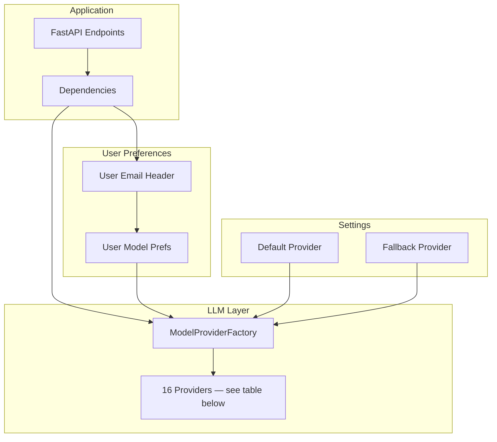
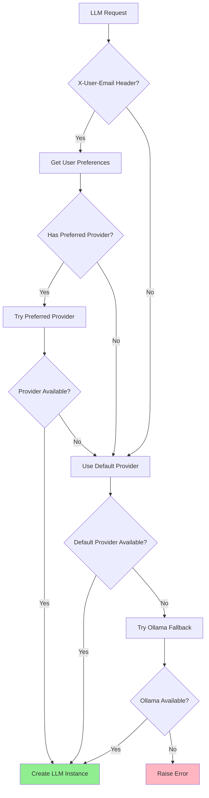

# LLM Integration

This document describes the multi-provider Language Model integration system.

## Overview

The system uses a factory pattern to support multiple LLM providers with automatic fallback and user preference support.

## Architecture Diagram



The factory owns 16 lazy-loaded OpenAI-compatible provider modules; each
is a single subclass of ``RemoteModelProvider`` (or ``LocalModelProvider``
for Ollama). See the table in *Supported Providers* below for the full
roster.

## Provider Selection Logic

The system uses a priority chain for provider selection:



### Selection Priority

1. **User Email Preference** (via `X-User-Email` header)
2. **Request Parameter Override** (explicit `provider`/`model` params)
3. **Settings Default** (`DEFAULT_PROVIDER`, `DEFAULT_MODEL`)
4. **Ollama Fallback** (if `OLLAMA_BASE_URL` configured)

## Supported Providers

Sixteen providers are wired through ``ModelProviderFactory``. Most ride
on the same OpenAI-compatible chat client (``ChatOpenAI``); only Anthropic
and Google use their native SDKs. Per-provider model catalogs come from
each provider's ``list_models()`` — the row count varies as new models ship.

| Provider | Slug | Base URL (or SDK) | Env var | Notes |
|----------|------|-------------------|---------|-------|
| OpenAI | `openai` | api.openai.com | `OPENAI_API_KEY` | Native SDK |
| Anthropic | `anthropic` | api.anthropic.com | `ANTHROPIC_API_KEY` | Native SDK |
| Google Gemini | `google` | generativelanguage.googleapis.com | `GOOGLE_API_KEY` | Native SDK |
| Grok (xAI) | `grok` | api.x.ai/v1 | `XAI_API_KEY` | OpenAI-compat |
| DeepSeek | `deepseek` | api.deepseek.com | `DEEPSEEK_API_KEY` | OpenAI-compat |
| OpenRouter | `openrouter` | openrouter.ai/api/v1 | `OPENROUTER_API_KEY` | Aggregator, 400+ models |
| Groq | `groq` | api.groq.com/openai/v1 | `GROQ_API_KEY` | LPU speed |
| Mistral | `mistral` | api.mistral.ai/v1 | `MISTRAL_API_KEY` | EU-hosted |
| Qwen | `qwen` | dashscope.aliyuncs.com/compatible-mode/v1 | `DASHSCOPE_API_KEY` | OpenAI-compat |
| ZAI (Zhipu) | `zai` | open.bigmodel.cn/api/paas/v4 | `ZHIPUAI_API_KEY` | OpenAI-compat |
| Moonshot (Kimi) | `moonshot` | api.moonshot.cn/v1 | `MOONSHOT_API_KEY` | OpenAI-compat |
| OpenCode | `opencode` | opencode.ai/zen/go/v1 | `OPENCODE_API_KEY` | Coding-models router |
| Together AI | `together` | api.together.xyz/v1 | `TOGETHER_API_KEY` | 200+ open-source, OpenAI-compat |
| Fireworks AI | `fireworks` | api.fireworks.ai/inference/v1 | `FIREWORKS_API_KEY` | Sub-200ms TTFT, OpenAI-compat |
| HuggingFace | `huggingface` | router.huggingface.co/v1 | `HUGGINGFACE_API_KEY` | 100k+ community models |
| Ollama | `ollama` | localhost:11434 | *(local)* | No API key, runs on host |

The full model list for each provider lives in
``apps/api/models/providers/<slug>.py`` — those files are the source of
truth, not this doc. The factory dynamically registers the 16 slugs via
``ModelProviderFactory.list_providers()``.

### Configuration example (OpenAI default)

```python
# Application env (see .env.example for the full set)
OPENAI_API_KEY=sk-...
DEFAULT_PROVIDER=openai
DEFAULT_MODEL=gpt-4o
```

Setting ``DEFAULT_PROVIDER`` to any slug from the table above flips the
default for new chat requests without code changes; per-request overrides
flow through the ``X-User-Email`` header → ``preferred_provider`` preference.

### Ollama (Local)

Ollama is the only local provider — no API key, runs on the host at
``OLLAMA_BASE_URL`` (default ``http://localhost:11434``). It is the
cascade fallback when ``ENABLE_MULTI_KEY_FALLBACK=true`` and no remote
provider has a valid key.

## ModelProviderFactory

The factory provides a unified interface for all providers. The class
itself is slim — provider classes live in
``apps/api/models/providers/<slug>.py`` and are loaded lazily on Render
to stay under the 512 MB free-tier memory cap (see the module docstring
in ``provider_factory.py`` for the warm/cold split):

```python
class ModelProviderFactory:
    _PROVIDERS: Dict[str, Type[ModelProvider]] = {}
    # Filled at module load time (eagerly outside Render, lazily on Render)
    # via _PROVIDER_MODULES -> _class_name_for().
```

### Factory Methods

```python
# List all 16 providers
providers = ModelProviderFactory.list_providers()
# ['openai', 'anthropic', 'google', 'grok', 'deepseek', 'openrouter',
#  'groq', 'mistral', 'qwen', 'zai', 'moonshot', 'opencode',
#  'together', 'fireworks', 'huggingface', 'ollama']

# Get a specific provider
provider = ModelProviderFactory.get_provider("fireworks")

# List all models from all providers
models = ModelProviderFactory.list_all_models()

# Create a model by ID
llm = ModelProviderFactory.create_model(
    model_id="accounts/fireworks/models/llama-v3p3-70b-instruct",
    temperature=0.7,
    max_tokens=4096,
)

# Get provider availability
status = ModelProviderFactory.get_available_providers()
# [('openai', True, None), ('anthropic', False, 'API key missing'),
#  ('fireworks', True, None), ...]
```

### Registering a new provider

Two seams: drop a subclass file in ``apps/api/models/providers/`` and add
the slug to ``_PROVIDER_MODULES`` + ``_PROVIDER_KEY_MAP`` in
``provider_factory.py``. Add a Pydantic field + ``update_api_key()``
branch in ``config/settings.py`` for runtime key rotation. Mirror the
``deepseek.py`` template for OpenAI-compatible providers; Anthropic and
Google are the only two that take their own SDK path.

## Dependency Integration

LLM instances are injected via FastAPI dependencies:

```python
# apps/api/api/dependencies.py

def get_llm(
    x_user_email: Annotated[str | None, Header(alias="X-User-Email")] = None,
) -> BaseChatModel:
    """Get Language Model instance with user preference support."""
    default_provider = settings.default_provider
    default_model = settings.default_model

    # Try user preference
    if x_user_email:
        prefs = MODEL_PREFS_MANAGER.get_preferences(x_user_email)
        if prefs.preferred_provider:
            try:
                return _create_llm(prefs.preferred_provider, prefs.preferred_model)
            except Exception:
                pass  # Fall back to default

    # Use default
    return _create_llm(default_provider, default_model)
```

### Usage in Endpoints

```python
@router.post("/api/v1/chat")
async def chat(
    request: ChatRequest,
    llm: BaseChatModel = Depends(get_llm),
    api_key: str = Depends(get_api_key),
):
    # llm is automatically initialized with user preferences
    agent = get_agent(llm=llm)
    result = agent.process_query(request.message)
    return result
```

## User Model Preferences

Users can store their preferred provider and model:

```python
# apps/api/models/user_model_preferences.py

class ModelPreferences(BaseModel):
    email: str
    preferred_provider: Optional[str] = None
    preferred_model: Optional[str] = None

# Set preferences
MODEL_PREFS_MANAGER.set_preferences(
    email="user@example.com",
    provider="anthropic",
    model="claude-3-5-sonnet-20241022"
)

# Get preferences
prefs = MODEL_PREFS_MANAGER.get_preferences("user@example.com")
```

## LLM Configuration

### Temperature and Tokens

```python
# config/settings.py

default_temperature: float = 0.7
default_max_tokens: int = 4096

# Per-request override
llm = ModelProviderFactory.create_model(
    model_id="gpt-4o",
    temperature=0.3,  # More deterministic
    max_tokens=8192,  # Longer responses
)
```

### Streaming Support

All providers support streaming responses:

```python
llm = ModelProviderFactory.create_model(
    model_id="gpt-4o",
    streaming=True
)

for chunk in llm.stream("Hello, world!"):
    print(chunk.content)
```

## Model Information

Each model provides metadata:

```python
class ModelInfo(BaseModel):
    id: str
    display_name: str
    provider_name: str
    context_window: int
    capabilities: List[ModelCapability]
    pricing: Optional[PricingInfo] = None
    description: Optional[str] = None
    recommended_for: List[str] = []

# Example
info = ModelInfo(
    id="gpt-4o",
    display_name="GPT-4o",
    provider_name="openai",
    context_window=128000,
    capabilities=[ModelCapability.VISION, ModelCapability.FUNCTION_CALLING],
    pricing=PricingInfo(
        input_price_per_1m=2.50,
        output_price_per_1m=10.00
    ),
    recommended_for=["chat", "vision", "tools"]
)
```

## Error Handling

The system gracefully handles provider failures:

```python
try:
    llm = get_llm(x_user_email="user@example.com")
except RuntimeError as e:
    # All providers failed
    return {"error": "LLM service unavailable"}
```

### Provider Validation

Each provider validates its connection:

```python
provider = ModelProviderFactory.get_provider("openai")
is_valid, error = provider.validate_connection()

if not is_valid:
    logger.warning(f"OpenAI provider unavailable: {error}")
    # Try fallback provider
```

## Performance Optimization

### Provider Caching

Provider instances are cached by default:

```python
# First call creates instance
provider1 = ModelProviderFactory.get_provider("openai")

# Subsequent calls return cached instance
provider2 = ModelProviderFactory.get_provider("openai")

# provider1 is provider2
assert provider1 is provider2
```

### Bypass Cache

```python
# Create fresh instance with new config
provider = ModelProviderFactory.get_provider(
    "openai",
    config={"api_key": "new-key"},
    use_cache=False
)
```

## File Locations

| Component | File |
|-----------|------|
| Factory | `apps/api/models/provider_factory.py` |
| Base Provider | `apps/api/models/providers/base.py` |
| OpenAI | `apps/api/models/providers/openai.py` |
| Anthropic | `apps/api/models/providers/anthropic.py` |
| Google | `apps/api/models/providers/google.py` |
| Ollama | `apps/api/models/providers/ollama.py` |
| User Prefs | `apps/api/models/user_model_preferences.py` |
| Dependencies | `apps/api/api/dependencies.py` |
